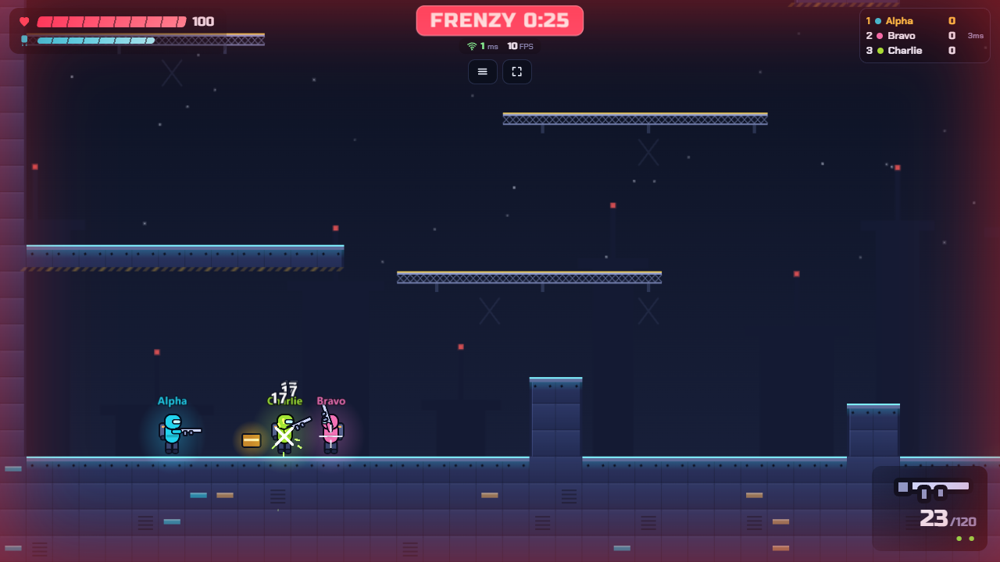

# THRUSTLINE

A side-view jetpack shooter (free-for-all or red vs blue teams) for 1–8 players, playable in the browser on phones and laptops.
Riggers, jetpack contractors, fight over **RIG-7**, an abandoned sky refinery above an acid sea.

**Play:** https://thrustline-drab.vercel.app · **Database:** SpacetimeDB Maincloud, `thrustline-zhtm`

Open the link and create a room. Press **Share** (or **Copy invite**) in the lobby and send the link to
your group: anyone who opens it lands straight in your room with an automatic callsign (a number is
added if two people pick the same name). No accounts: closing the tab removes you. Playing alone?
Press **Add CPU** in the lobby.



## How to play

Most score when the timer runs out wins.

| Event | Score |
| --- | --- |
| Kill | +100 |
| Kill a **bounty** target (a player on a 3-kill streak, glowing gold with a crown) | +50 extra |
| Die to acid or your own grenade | −50 |

Leaderboard order: score, then kills, then fewer deaths. HP has no regeneration; you respawn after a
fixed 5 seconds with 1.5 s of spawn protection (a bubble; it ends early if you attack). Your ping
and FPS are always shown under the timer; everyone's ping is on the mini leaderboard and scoreboard.

### Controls

| Action | Keyboard & mouse | Touch (landscape) |
| --- | --- | --- |
| Move | A / D | Left stick (rests bottom-left; slides to wherever your left thumb lands) |
| Jetpack (tap = hop, hold = fly) | W or Space | Push the left stick up: analog. A gentle push hovers (you can drift sideways at one height), further climbs |
| Drop through a platform | S | Pull the left stick firmly straight down |
| Aim | Mouse | Right stick direction |
| Fire | Left click or E (hold for AR) | Push the right stick past ~55 % (keeps firing while held) |
| Knife | Right click or R | Knife button |
| Grenade | G | Grenade button (Arms and Boom) |
| Swap weapon | F | Swap button |
| Reload | T | Reload button |
| Emote | Q | Emote button (beside the leaderboard) |
| Scoreboard | Hold Tab | Tap the mini leaderboard |
| Menu / detailed stats | Esc / F3 | ≡ button / Settings |

Touch buttons sit on an arc around the aim stick and only appear when the mode uses them.

### Modes (host chooses in the lobby)

| Mode | Loadout | Pickups |
| --- | --- | --- |
| **Arms** (default) | Pistol, one primary (AR, SMG, shotgun or sniper, picked on the respawn screen), knife, 2 frags | Health, ammo, grenade |
| **Blades** (melee only) | Knife only, +15 % run speed | Health |
| **Boom** (grenades only) | Unlimited frags (0.85 s cooldown, max 3 live), knife backup | Health |
| **Snipers** | Sniper rifle and knife | Health, ammo |

### House rules (host sets them in the lobby)

| Setting | Options |
| --- | --- |
| Round length | 2, 3, 5, 8 or 10 minutes (30 s in `?dev=1` rooms) |
| Health | 50, 100, 150 or 200 HP |
| CPU skill | Easy, Normal, Hard |
| Infinite jetpack | Fuel never runs out |
| Infinite ammo | No reloading; unlimited grenades in Arms |
| Pickups | Crates on or off |
| Acid hazard | The pit burns, or is harmless |
| Final-minute Frenzy | On or off |
| Match type | Free-for-all, or Red vs Blue teams (1v1, 2v2 … 4v4; up to 8 players) |
| Friendly fire | Teams only, on by default: teammates' hits count (a teamkill costs 50) |
| Floating grenades | Zero-g: grenades drift where you throw them and slow to a stop |

Everyone in the room sees the settings; only the host can change them. Every toggle starts **on**
(infinite jetpack, infinite ammo, pickups, acid, Frenzy, floating grenades), so a fresh room is the
fastest, most chaotic version; the host turns off whatever the group does not want. The server
enforces every rule. The host can also **kick** a player (✕ on their row; they can't rejoin that
room) and move players between teams (⇄). In a team match each player can press **Switch team**.

After a round, everyone sees the results, then the whole room returns to the lobby automatically
after 12 seconds (the host can press **Play again** or **Lobby now** sooner).

### Teams

Red vs Blue: soldiers, name tags, the minimap and the kill feed use the team colour, and teammates
carry a small chevron above their name. The score bar under the timer shows the two team totals;
the team with the higher total wins.

### Radar

The minimap (top left) always shows you and your teammates. An enemy appears on it only for a few
seconds after they fire, so hiding works until you shoot. When an enemy who is **off-screen** fires,
an arrow at the screen edge points toward them; enemies already on screen get no arrow.

### Ping

The game server is SpacetimeDB Maincloud, which runs in Virginia, USA. From India the network round
trip alone is about 230–250 ms, so that is the ping you will see. The netcode is built to stay smooth
and fair at that latency (see Architecture). A lower ping would need a SpacetimeDB server closer to
the players. **[deploy/oracle/](deploy/oracle/README.md)** sets one up for free on Oracle Cloud's Always Free tier in
Hyderabad/Mumbai (measured ~25–40 ms from India vs ~250 ms to Maincloud and 87–235 ms via Cloudflare):
one setup script on the server, then change `VITE_STDB_URI` and run `npm run deploy`.

### Weapons

| Weapon | Damage | Rate | Mag / reserve | Notes |
| --- | --- | --- | --- | --- |
| Pistol | 18 | 4/s | 12 / ∞ | Always carried |
| AR | 11 | 10/s | 30 / 120 | Automatic; spread grows while moving |
| SMG | 8 | 14/s | 35 / 140 | Latency-friendly: many fast shots and forgiving spread; falls off past 450 px |
| Shotgun | 7 × 9 | 1.1/s | 6 / 24 | Falls off past 180 px; recoil throws you back (blast-jumping) |
| Sniper | 85 | 0.8/s | 4 / 16 | Pinpoint while still; camera leads 320 px |
| Knife | 55 | 2/s | — | Short lunge |
| Frag | up to 100 | — | 2 per life | 1.5 s fuse, bounces, knockback, half damage to yourself |

Solid metal (glowing cyan edges) blocks bullets. The see-through mesh catwalks (yellow top rail) are
one-way platforms: you can jump up through them and bullets pass through them.

## What makes it THRUSTLINE (customisation)

- **Jetpack fuel:** 100 fuel, ~2.9 s of flight, refills after 0.12 s on the ground (a full tank in ~1.4 s). Tap for a hop, hold to fly.
- **Blast-jumping:** shotgun recoil (520) and grenade knockback (700) push you; chain them with the jetpack to move fast.
- **Bounty:** a 3-kill streak makes you glow gold and worth +50 to whoever stops you.
- **Frenzy:** the last 60 s: damage ×1.5, fuel refills twice as fast, red edge tint, FRENZY banner, faster music.
- **Modes and house rules:** four loadouts plus host-set health, fuel, ammo, pickups, acid and Frenzy. Respawn is always 5 s.
- **Emotes:** press Q (or tap the button beside the leaderboard) and pick one of eight Hinglish stickers. They pop above you and follow you while you move; when you die the picker opens automatically and your sticker stays at the death spot while you wait to respawn.
- **Acid hazard:** the pit in the middle burns 30 HP/s while you're in it. You can fly out.
- **Smart spawns:** never within 200 px of where you died, preferring points far from living enemies.
- **CPU players:** computer opponents with three difficulty levels and human limits (reaction time,
  aim error, burst fire, delayed perception). They join as real clients and obey the same server rules.

Every number lives in [server/src/shared/config.ts](server/src/shared/config.ts) and [server/src/shared/weapons.ts](server/src/shared/weapons.ts).

## Run locally

Requirements: Node 20+, the [SpacetimeDB CLI](https://spacetimedb.com/install) (2.14+).

```bash
npm install
spacetime start                      # local database server on :3000 (leave running)
npm run publish:local                # publish the module as "thrustline-dev"
npm run gen                          # regenerate client bindings (only after schema changes)
npm run dev                          # Vite on http://localhost:5173
```

Open several tabs: each tab is a separate player (the identity token lives in `sessionStorage`).

Checks:

```bash
npm run typecheck                    # strict TypeScript, server + client
npm test                             # Vitest unit tests for the shared simulation
npx playwright install chromium      # once
npm run e2e                          # multi-client browser tests against the local dev server
BASE_URL=https://thrustline-drab.vercel.app PLAYERS=2 npx playwright test smoke bots   # production
```

## Deploy

```bash
spacetime login                      # once (browser)
vercel login                         # once
npm run deploy                       # typecheck, tests, generate, publish to Maincloud, build, vercel --prod
```

`npm run deploy` publishes the module to the database named in `client/.env.production` and deploys
the client from the repo root (see `vercel.json`). If a schema change is incompatible, run
`npm run publish:cloud -- --delete-data` once (all match data is disposable).

### Offline LAN fallback

No internet? One laptop hosts everything on the same Wi-Fi (or a phone hotspot, laptop as host):

```bash
spacetime start
npm run publish:local
cd client
VITE_STDB_URI=ws://<laptop-ip>:3000 VITE_STDB_DB=thrustline-dev npx vite build
npx vite preview --host              # players open http://<laptop-ip>:4173
```

That page isn't a secure context, so WebGPU is unavailable and PixiJS uses WebGL.

## Architecture

Each browser simulates its own soldier with the shared physics at a fixed 60 Hz and sends one `sync`
reducer call every 50 ms (200 ms when idle) with its position and any shots, knife swings or throws.
The SpacetimeDB module is the referee: it validates movement (no teleports, no walls), validates hit
claims with tolerances that favour the shooter, and owns everything that decides the match (HP, kills,
score, ammo, pickups, grenades, spawns, the clock). There is no server tick: respawns, round end,
grenade fuses and pickup timers are one-shot scheduled reducers. Clients subscribe only to their room;
other players are interpolated on the sender's own timeline, drawn just far enough in the past
(adaptively, from measured lag and jitter) that there is always real data to show, and transient effects (shots, hits, kills,
explosions) arrive through event tables. Grenades follow a deterministic simulation that server and
clients run on the same stored inputs, so they explode exactly where they are drawn.

### Fair play (why cheating is limited)

The browser is never trusted. Clients simulate their own soldier, but the module decides every
outcome that matters:

- **Movement:** speed, walls, map bounds and a capped client-clock debt (350 ms) are checked on every
  sync; a rejected position is answered with a correction counter and the client snaps back.
- **Damage:** the server owns HP, kills, score, ammo and pickups. A client sends hit *claims*, and
  each claim is checked against the shooter's server-side position, the weapon's range, a tile
  raycast (cover wins) and the target's lag-compensated history. Pellet count and fire rate are
  capped by the weapon definition.
- **Actions:** only the equipped weapon from the mode's loadout can fire; shots, knives, reloads and
  grenade throws are rate-limited per player and per weapon.
- **Replays:** every sync carries a monotonically increasing sequence number. Replayed, duplicated or
  late packets are dropped before they can act, and a reconnecting page starts a fresh sequence.
- **Identity:** room codes must match the alphabet exactly, room creation/joins and pings are
  rate-limited per identity, and names drop control, zero-width and bidirectional characters so two
  players cannot appear to share a name.

Two limits are inherent to a client-rendered game and are not fixable with server checks: a modified
client can draw information it already receives (positions of everyone in its room are public so
they can be rendered), and it can aim perfectly or ignore its own spread. The server still decides
whether a claimed hit is legal. For a public deployment, pair this with platform-level rate limiting
and a way to receive reports; never rely on a client-side anti-cheat.

```text
server/src/index.ts        tables, reducers, scheduled jobs, event tables (the referee)
server/src/shared/         physics, map, raycasts, grenades, spawns, validation, config (server AND client)
client/src/net/            connection, subscriptions, clock sync, interpolation buffers
client/src/game/           fixed-step loop, local player (Actor), camera, input, CPU bots
client/src/render/         generated atlas, baked map, soldier animation, particles, effects
client/src/audio/          synthesised sounds and music, mixer
client/src/ui/             HUD, touch controls, settings
tests/e2e/                 Playwright multi-client tests
docs/                      ALGORITHMS.md, LAB_MAPPING.md, screenshots/
```

Full explanation for presenting and the viva: **[docs/GAME_GUIDE.md](docs/GAME_GUIDE.md)** · More detail: [docs/ALGORITHMS.md](docs/ALGORITHMS.md) · Lab requirements: [docs/LAB_MAPPING.md](docs/LAB_MAPPING.md) · Deviations: [DECISIONS.md](DECISIONS.md)

## Stack

| Layer | Choice | Why |
| --- | --- | --- |
| Language | TypeScript (strict) | One language for client, server and the shared simulation |
| Client build | Vite | Fast dev server; static `dist/` that Vercel hosts directly |
| Rendering | PixiJS v8 (WebGPU → WebGL) | Batched sprites from one atlas; WebGPU where available |
| UI | Plain DOM + CSS | Crisp text, tiny bundle, no per-frame virtual DOM |
| Audio | Web Audio API | Low latency; every sound synthesised in code |
| Backend | SpacetimeDB 2.14 TypeScript module | Tables, reducers, subscriptions and scheduling in one place |
| Client SDK | `spacetimedb` npm package | Typed bindings generated from the module |
| Tests | Vitest + Playwright | Unit tests for the simulation; real multi-browser games end to end |
| Hosting | Vercel + SpacetimeDB Maincloud | Static client on a CDN; managed database |

All art and sound are generated in code at load. The only bundled assets are two open-licence (OFL)
fonts, Russo One and Chakra Petch, installed from npm and served with the app. The whole client is
about 240 KB of gzipped JavaScript and CSS plus 37 KB of fonts.
