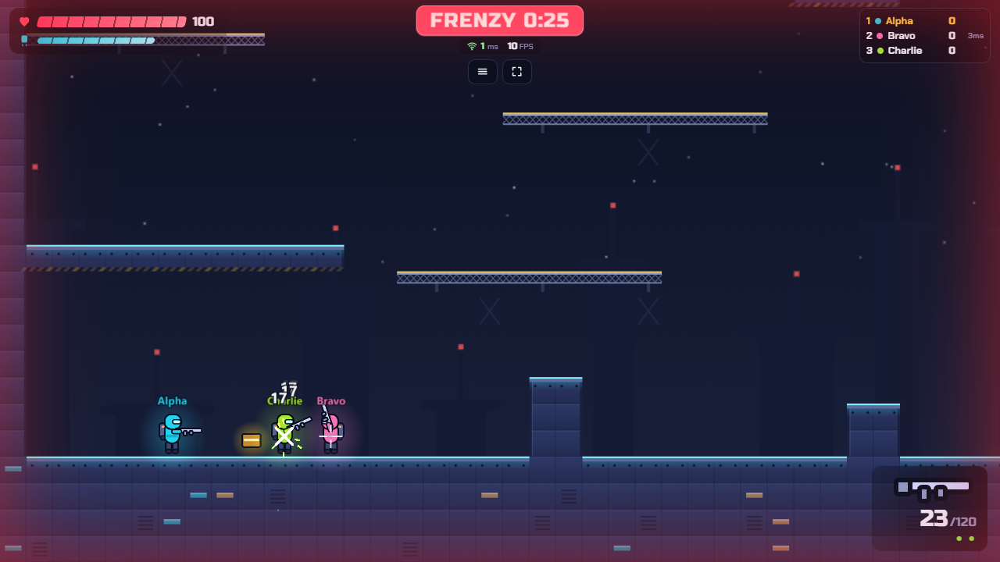

# THRUSTLINE

A side-view jetpack shooter for 1–8 players, free-for-all or red vs blue, in the browser on phones
and laptops and as an Android app. Riggers, jetpack contractors, fight over abandoned sky
refineries above an acid sea.

**Play:** https://thrustline-drab.vercel.app · **Android:** [android/](android/README.md) · **Database:** SpacetimeDB Maincloud, `thrustline-zhtm`



Press **Quick Play** to join a public match at once: CPU players fill empty seats and rounds run
back to back. To play with friends, **Create room** and send the invite link from the lobby; anyone
who opens it lands in your room. There is no sign-up. Your level and season points stay with your
browser, and if your connection drops, your slot and score are held for 30 seconds.

## How to play

The highest score when the timer runs out wins.

| Event | Score |
| --- | --- |
| Kill | +100 |
| Kill a **bounty** (a player on a 3-kill streak, glowing gold) | +50 extra |
| Hold the hill (King of the Hill) | +10 a second |
| Bring the enemy flag home (Capture the Flag) | +300 |
| Take the enemy flag / return your own / kill the carrier | +25 / +50 / +50 extra |
| Die to acid or your own grenade, or kill a teammate | −50 |

You respawn 5 seconds after dying, with 1.5 s of spawn protection. Health does not regenerate.

### Controls

| Action | Keyboard and mouse | Touch (landscape) |
| --- | --- | --- |
| Move | A / D | Left stick |
| Jetpack (tap to hop, hold to fly) | W or Space | Push the left stick up; a gentle push hovers |
| Drop through a platform | S | Pull the left stick down |
| Aim and fire | Mouse, left click or E | Right stick, pushed past halfway |
| Knife · grenade · swap · reload | Right click or R · G · F · T | Buttons around the right stick |
| Emote · scoreboard · menu | Q · hold Tab · Esc | Emote button · tap the mini leaderboard · ≡ |

Every key can be remapped in **Settings**, which also has a colour-blind palette and camera shake
and particle sliders. Gamepads work too.

### Modes and maps

The host sets up the room in the lobby; everyone sees the settings and the server enforces them.

- **Loadouts:** Arms (pistol, a primary of your choice, knife, grenades), Blades (knives only),
  Boom (grenades only) and Snipers.
- **Objectives:** Deathmatch, King of the Hill or Capture the Flag; free-for-all or teams up to 4v4.
- **Maps:** RIG-7, HELIOS-9, KILN-3, SKYREACH and CRYO-12, or a different one every round.
- **House rules:** round length, health, CPU skill, infinite fuel and ammo, pickups, airdrops,
  acid, Frenzy, sudden death, friendly fire and floating grenades.

Arms and Boom rounds open with an 8 second loadout screen: the gun and grenade you pick stay with
you until you die. Quick Play rotates the maps and objectives.

### What makes it THRUSTLINE

- **Jetpack:** about 2.9 s of flight, and a full tank again within 1.4 s on the ground.
- **Blast-jumping:** shotgun recoil and grenade blasts throw you; chain them with the jetpack.
- **Bounty:** a 3-kill streak makes you glow gold and worth +50 to whoever stops you.
- **Frenzy:** in the last minute damage is ×1.5 and fuel refills twice as fast. In the last 30 s
  the acid rises from the floor.
- **Pickups:** health, shields, ammo and grenade crates, and a railgun airdrop every minute.
- **Radar:** an enemy shows on the minimap only for a few seconds after they fire.
- **CPU players:** three skill levels with human limits. They join as real clients and obey the
  same server rules.
- **Levels and seasons:** finished rounds pay XP, levels unlock sticker emotes, and a monthly
  season board lists the top 20.

Every number lives in [config.ts](server/src/shared/config.ts) and
[weapons.ts](server/src/shared/weapons.ts). The full rules, the weapon table and the design are in
the **[game guide](docs/GAME_GUIDE.md)**.

## Run locally

Requirements: Node 20+ and the [SpacetimeDB CLI](https://spacetimedb.com/install) (2.14+).

```bash
npm install
spacetime start                      # local database server on :3000 (leave running)
npm run publish:local                # publish the module as "thrustline-dev"
npm run gen                          # regenerate client bindings (only after schema changes)
npm run dev                          # Vite on http://localhost:5173
```

Open several tabs to get several players: each extra tab is a separate guest. Rooms created with
`?dev=1` allow test teleports, are labelled TEST ROOM and never count for levels or the season.

```bash
npm run typecheck                    # strict TypeScript, server + client
npm test                             # Vitest unit tests for the shared simulation
npx playwright install chromium      # once
npm run e2e                          # multi-client browser tests against the local dev server
BASE_URL=https://thrustline-drab.vercel.app PLAYERS=2 npx playwright test smoke bots   # production
```

## Deploy

```bash
spacetime login                      # once (browser)
vercel login                         # once
npm run deploy                       # typecheck, tests, generate, publish to Maincloud, build, vercel --prod
```

`npm run deploy` publishes the module to the database named in `client/.env.production` and deploys
the client from the repo root (see `vercel.json`).

**Never use `--delete-data` on production.** `profile` and `season_board` hold every player's level
and season points. Schema changes must migrate in place: add new tables, or add columns to the end
of a table with `.default()`. Try a change on a throwaway local database first.

Maincloud runs in Virginia, about 250 ms from India, and the netcode is built to stay fair at that
latency. [deploy/README.md](deploy/README.md) is the runbook for moving to your own server, closer
to the players, with every player's level carried across.

### Offline LAN fallback

No internet? One laptop hosts everything on the same Wi-Fi or a phone hotspot:

```bash
spacetime start
npm run publish:local
cd client
VITE_STDB_URI=ws://<laptop-ip>:3000 VITE_STDB_DB=thrustline-dev npx vite build
npx vite preview --host              # players open http://<laptop-ip>:4173
```

That page isn't a secure context, so PixiJS uses WebGL instead of WebGPU.

## Android

[android/](android/) is the Google Play app: a Trusted Web Activity that opens this site full
screen in Chrome, so every web deploy updates the app as well. The release build is about 225 KB.
[android/README.md](android/README.md) covers building, releasing and the road to Google Play, and
[android/STORE_LISTING.md](android/STORE_LISTING.md) has the listing text.

## Architecture

Each client simulates its own soldier with the shared physics at a fixed 60 Hz and sends a `sync`
reducer call every 50 ms (200 ms when idle) with its position and any shots, knife swings or throws.
The SpacetimeDB module is the referee: it checks movement against the map and the physics, checks
every hit claim against cover and the target's lag-compensated history, and owns everything that
decides the match (HP, kills, score, ammo, pickups, grenades, spawns, the clock). There is no server
tick: respawns, round end, grenade fuses and pickup timers are one-shot scheduled reducers. Other
players are interpolated on the sender's own timeline with an adaptive delay, and grenades follow a
deterministic simulation that server and clients run on the same inputs.

The browser is never trusted. The server rejects impossible movement, blocked or out-of-range hits,
the wrong weapon, fire faster than the weapon allows and replayed packets, and it awards all XP and
season points itself. A modified client can still draw what it receives and aim perfectly; the
server decides whether each hit is legal. The full list is in
[the guide](docs/GAME_GUIDE.md#16-cheating-what-the-server-checks-and-what-it-trusts).

```text
server/src/index.ts        tables, reducers, scheduled jobs, event tables (the referee)
server/src/shared/         physics, map, raycasts, grenades, spawns, validation, config (server AND client)
client/src/net/            connection, subscriptions, clock sync, interpolation buffers
client/src/game/           fixed-step loop, local player (Actor), camera, input, CPU bots
client/src/render/         generated atlas, baked map, soldier animation, particles, effects
client/src/audio/          synthesised sounds and music, mixer
client/src/ui/             HUD, touch controls, settings
android/                   Google Play app (Trusted Web Activity)
tests/e2e/                 Playwright multi-client tests
docs/                      GAME_GUIDE.md, ALGORITHMS.md, LAB_MAPPING.md, screenshots/
```

More: [docs/GAME_GUIDE.md](docs/GAME_GUIDE.md) (full explanation) ·
[docs/ALGORITHMS.md](docs/ALGORITHMS.md) · [docs/LAB_MAPPING.md](docs/LAB_MAPPING.md) ·
[DECISIONS.md](DECISIONS.md)

## Stack

| Layer | Choice | Why |
| --- | --- | --- |
| Language | TypeScript (strict) | One language for client, server and the shared simulation |
| Client build | Vite | Fast dev server; static `dist/` that Vercel hosts directly |
| Rendering | PixiJS v8 (WebGPU → WebGL) | Batched sprites from one atlas; quality adapts to the device |
| UI | Plain DOM + CSS | Crisp text, tiny bundle, no per-frame virtual DOM |
| Audio | Web Audio API | Low latency; every sound synthesised in code |
| Backend | SpacetimeDB 2.14 TypeScript module | Tables, reducers, subscriptions and scheduling in one place |
| Client SDK | `spacetimedb` npm package | Typed bindings generated from the module |
| Android | Trusted Web Activity (Kotlin) | A tiny app that runs this site in Chrome and updates with it |
| Tests | Vitest + Playwright | Unit tests for the simulation; real multi-browser games end to end |
| Hosting | Vercel + SpacetimeDB Maincloud | Static client on a CDN; managed database |

All art and sound are generated in code at load. The only bundled assets are two open-licence (OFL)
fonts, Russo One and Chakra Petch. The whole client is about 240 KB of gzipped JavaScript and CSS
plus 37 KB of fonts.
